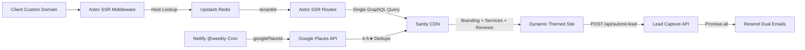

# Boutique WaaS Engine & Multi-Tenant Storefront
Server-rendered, multi-tenant Website-as-a-Service (WaaS) platform for trade and home-service businesses. Built to solve a common bottleneck for digital agencies: spinning up fast, branded local-trade websites without maintaining separate codebases, duplicating CMS instances, or manually copy-pasting Google Reviews. Resolves custom client domains to tenant IDs at the edge via **Upstash Redis**, hydrates branding, services, and reviews in a single **Sanity GraphQL** query, routes quote leads through **Resend**, and syncs 4–5★ **Google Reviews** automatically every week.

## End-to-End Request Flow

## Key Engineering & Hardening Decisions
* **Zero-Redeploy Host Routing:** Astro SSR middleware intercepts every request, resolves the incoming `Host` header against Upstash Redis over REST, and injects `Astro.locals.tenantId` (with explicit `LOCAL_TEST_TENANT_ID` overrides in dev and `tenant_not_found` / `tenant_error` fallbacks in production) so one Netlify deployment serves unlimited client domains.
* **Single-Round-Trip Hydration & Dynamic Theming:** `getLayoutAndHomeData()` fetches tenant branding, service catalogs, and reviews in one Sanity GraphQL CDN call, injecting each client's `primaryColor` directly into `--theme-primary` via Astro's `define:vars` alongside auto-generated `LocalBusiness` JSON-LD structured data and safe default fallbacks.
* **Tenant-Isolated Service Pages:** On-demand SSR routes (`/services/[slug]`) enforce strict tenant scoping by querying Sanity on both `tenantId` and `slug`, redirecting invalid or cross-tenant URLs cleanly to `/404`.
* **Agency-First Sanity Studio & Shared Control Plane:** Custom Structure Builder organizes clients into scoped workspaces with filtered `service` and `review` lists, using `initialValueTemplates` (`service-by-tenant`, `review-by-tenant`) to auto-tag hidden `tenantId` fields on creation. The unified `tenant` document also centralizes operational fields (`isActive`, `serviceArea`, `businessHours`, `twilioForwardingNumber`, `aiCustomInstructions`) consumed downstream by the AI Receptionist.
* **Automated Weekly Review Ingestion:** A scheduled Netlify Function (`@weekly`) queries all tenants with a `googlePlaceId`, pulls reviews from the Google Places Details API, filters strictly for 4- and 5-star ratings, and deduplicates on `googleReviewId` before writing new documents to Sanity.
* **Parallel Lead Capture Dispatch:** `POST /api/submit-lead` validates quote form submissions server-side and fires dual Resend notifications concurrently via `Promise.all`—alerting the business with full job details while sending an instant confirmation receipt to the customer.

## Tech Stack
* **Framework & Styling:** Astro v7 (SSR mode), TypeScript, Tailwind CSS v4 (hosted on Netlify)
* **Edge Routing:** Astro Middleware, Upstash Redis (REST API)
* **CMS & Studio:** Sanity CMS v6 (GraphQL CDN API & custom Structure Builder Studio), React 19
* **Email & Background Sync:** Resend API, Netlify Scheduled Functions, Google Places API
